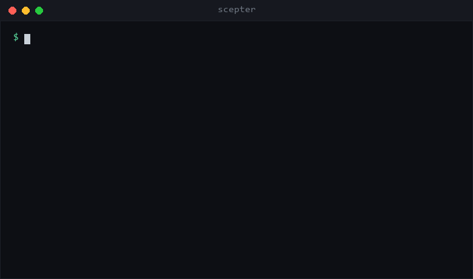

# Scepter

**Is this MCP server alive, maintained, and safe to use?**

[](https://www.npmjs.com/package/scepter-mcp)
*(Scepter checking itself: `scepter badge scepter-mcp --npm`)*



More than half of published MCP servers are already dead, and only a fraction of the tens of thousands out there are actively maintained. Developers wire them into their AI agents without knowing which ones are abandoned, unmaintained, or risky. Scepter answers that question in one command.

```bash
npx scepter-mcp check owner/repo
```

## Install

```bash
# run without installing
npx scepter-mcp check <server>

# or install the command globally
npm install -g scepter-mcp
scepter check <server>
```

Requires Node 18 or newer. No runtime dependencies.

## Usage

Check one server, by GitHub repo or npm package:

```bash
scepter check owner/repo
scepter check https://github.com/owner/repo
scepter check some-mcp-server
scepter check @scope/name
```

Scan every server in an MCP config file:

```bash
scepter scan ./mcp.json
```

```
  HEALTHY  88  owner/weather-mcp
  CAUTION  61  another/mcp-thing
  RISKY    22  abandoned/old-mcp

  1 healthy   1 caution   1 risky
```

Options:

| Flag | Effect |
| --- | --- |
| `--github` | read the target as a GitHub repo |
| `--npm` | read the target as an npm package |
| `--json` | print JSON instead of a report |
| `-h, --help` | show help |

Set `GITHUB_TOKEN` in your environment to raise the GitHub API rate limit.

Exit code is `1` when the verdict is risky, so you can use Scepter in CI.

## Track health over time, not just a snapshot

Every `check` logs its score to `~/.scepter/history`. The next time you check
the same target, the report shows what changed:

```
  SCORE 92/100 · HEALTHY
  ▲ +6 pts since last check (3d ago, was 86/100)
  ▁▃▅▆▇▇  6 checks recorded
```

If the verdict itself flips (healthy → caution, say), that's called out
explicitly, not left for you to notice by comparing two numbers.

## Watch a server instead of remembering to re-check it

```bash
scepter watch owner/repo --interval=60
```

Re-checks the target on a schedule (default every 30 minutes) and prints one
line per tick, same history file `check` reads its trend from. When a verdict
actually changes, it's flagged inline instead of scrolling past silently:

```
  Watching owner/repo every 60m. Ctrl+C to stop.

  14:02:11  HEALTHY  92/100
  15:02:14  HEALTHY  90/100
  16:02:09  CAUTION  61/100  ← changed
    owner/repo moved from healthy to caution (90 → 61/100).
```

Useful for a server you've already wired into an agent and want to know the
moment it starts to rot, instead of finding out when a tool call fails.

## Add a health badge to your README

```bash
scepter badge owner/repo
```

Prints a copy-paste Markdown badge:

```markdown
[](https://github.com/owner/repo)
```

## See what your agent actually calls

Static checks tell you if a server looks healthy. `wrap` tells you how it really
behaves. Put Scepter in front of the real server in your MCP client config:

```jsonc
{
  "mcpServers": {
    "weather": {
      "command": "npx",
      "args": ["-y", "scepter-mcp", "wrap", "--", "npx", "-y", "@scope/weather-mcp"]
    }
  }
}
```

Scepter forwards every byte unchanged, so your agent works exactly as before,
while recording each tool call, its result, timing, and any error locally under
`~/.scepter`. Then:

```bash
scepter report
```

```
  Recent MCP sessions   (2)

  SERVER                        CALLS   ERR    AVG    SLOW
  weather-mcp                      42     3    88ms   310ms
  files-mcp                        17     0    12ms    40ms

  Heads up
  - weather-mcp failed 3 of 42 calls (last: "upstream timeout"). Check it: scepter check weather-mcp
```

Nothing leaves your machine.

## Inspect what a server actually hands your agent

`check` reads metadata. `inspect` starts the server, completes the MCP handshake and audits the live tool list, the exact text your agent will read:

```bash
scepter inspect -- npx -y @playwright/mcp@latest
```

```
  @playwright/mcp (live, MCP 2025-06-18)

  ✓ Tools        25 tools, 25 with safety annotations
  ✓ Context      ~5,072 tokens of tool definitions on every turn
  ✓ Pinned       first inspection, tool list pinned for next time
  ✓ Tool audit   no poisoned or unmarked destructive tools

  HEALTHY
```

| Check | What it catches |
| --- | --- |
| **Tool poisoning** | descriptions or parameter docs that tell the model to hide things from you, ignore earlier instructions, read SSH or cloud keys, or redirect other tools |
| **Hidden text** | invisible Unicode (format and control characters); a message smuggled in Unicode tag characters is decoded and shown to you |
| **Unmarked destructive tools** | tools named like `delete_*`, `exec`, `drop_*` without a `destructiveHint`, so clients won't ask before running them |
| **Context cost** | how many tokens the tool definitions take on every turn, before you type anything; over 50,000 is flagged |
| **Runtime reach** | for Node servers, which powerful built-ins the server actually loads while starting: process spawning, networking, file system. What it brought along, not just what its tool list claims |
| **Rug pulls** | every tool is pinned to a hash in `~/.scepter/pins`; the next `inspect` reports any tool whose description or schema silently changed |

Measured on 11 Oct 2026:

| Server | Tools | Annotated | Context per turn |
| --- | --- | --- | --- |
| `@modelcontextprotocol/server-filesystem` | 14 | 14 | ~3,300 tokens |
| `@playwright/mcp` | 25 | 25 | ~5,100 tokens |
| `chrome-devtools-mcp` | 30 | 30 | ~6,600 tokens |
| `@wonderwhy-er/desktop-commander` | 26 | 26 | ~14,400 tokens |

Remote servers work the same way, over Streamable HTTP:

```bash
scepter inspect https://mcp.deepwiki.com/mcp
scepter inspect https://example.com/mcp --header "Authorization: Bearer $TOKEN"
```

The audit is pattern-based and runs entirely on your machine: no account, no API, nothing uploaded. Exit code is `1` on a risky verdict, so it works in CI.

## Audit your whole MCP setup

One server can look fine on its own and still be dangerous next to another. `audit` starts every server in a config (stdio and remote, with their own env and headers), inspects each one, then looks for **toxic flows**: one tool that reads untrusted content, one that reads private data, and one that can send data out. Together they let a malicious web page or issue steer your agent into leaking your files.

```bash
scepter audit ~/.cursor/mcp.json
scepter audit            # no path: finds the MCP configs of the common desktop and coding clients itself
```

A real setup of six popular servers, 11 Oct 2026:

```
  HEALTHY filesystem  14 tools, ~3,279 tokens
  HEALTHY playwright  25 tools, ~5,072 tokens
  HEALTHY chrome-devtools  30 tools, ~6,597 tokens
  HEALTHY desktop-commander  26 tools, ~14,396 tokens
  HEALTHY deepwiki  3 tools, ~385 tokens
  HEALTHY context7  2 tools, ~1,307 tokens

  Together: 100 tools, ~31,036 tokens of context on every turn

  ! Toxic flow  content from outside can steer the agent to read private data and send it out
    reads untrusted content: playwright/browser_navigate, playwright/browser_navigate_back, chrome-devtools/navigate_page
    reads private data:      filesystem/read_file, filesystem/read_text_file, filesystem/read_media_file +10
    can send it out:         playwright/browser_file_upload, chrome-devtools/upload_file

  CAUTION
```

Every server here is well built. The risk only exists in the combination, which is exactly what a per-server scanner can't see.

`audit` also flags **cross-server shadowing**: a tool whose description names another server's tool (say, a calculator that mentions `send_email`) is trying to steer how your agent uses a tool it doesn't own.

## Let your agent check servers itself

Scepter also runs as an MCP server, so your agent or any MCP client can check a server before wiring it in:

```json
{
  "mcpServers": {
    "scepter": { "command": "npx", "args": ["-y", "scepter-mcp", "serve"] }
  }
}
```

It exposes four tools, each with a title, safety annotations and a structured output schema:

| Tool | Input | Returns |
| --- | --- | --- |
| `check_server` | `target` (owner/repo or npm package), optional `source` | score, verdict and signals for one server |
| `scan_config` | `path` to an MCP config file, optional `source` | the same for every server in that config |
| `inspect_server` | `command` + `args`, or a `url` | live tool audit: poisoning, unmarked destructive tools, context cost, changes |
| `audit_config` | `path` to an MCP config file | every server inspected, plus toxic flows across them |

`inspect_server` and `audit_config` start the servers they examine, so they are not marked read-only: your client will ask before the agent launches anything.

## What it checks

| Signal | Weight | Reads |
| --- | --- | --- |
| **Activity** | 35 | last publish (npm) or last push (GitHub) |
| **Maintained** | 20 | archived flag, license, releases, link back to source |
| **Provenance** | 15 | stars, maintainers, open issues, description |
| **MCP fit** | 10 | whether it declares itself an MCP server |
| **Security** | 20 | known advisories, via GitHub's advisory database |

A known **critical** advisory overrides everything else: the verdict is `risky`
regardless of how well-maintained the project otherwise looks. Couldn't reach
the advisory API? That's reported as "could not check", not silently treated
as "no advisories" -- Scepter never claims more certainty than it has.

## What it does not do (yet)

Scepter does not sandbox the server, watch its network calls, or judge what a tool does at runtime beyond its declared description and annotations. Pattern checks can miss a cleverly worded poisoned description. Scepter never claims a server is "safe" or "undetectable", only what it can observe.

## Roadmap

- **v1**: health and trust check from metadata (`check`, `scan`, `badge`)
- **v2**: see which servers your agent actually calls, and their failures (`wrap`, `report`)
- **v2.5**: live audit of the tool list: poisoning, unmarked destructive tools, context cost, rug-pull pins (`inspect`)
- **v2.7**: whole-setup audit with toxic flows, remote HTTP servers, and every check available to agents as an annotated MCP tool (`audit`)
- **v2.8**: config auto-discovery, runtime reach, decoded hidden messages, cross-server shadowing, context-cost warnings *(this release)*
- **v3**: full traces, per-task cost, and replay, with the health check as one view

## License

MIT
